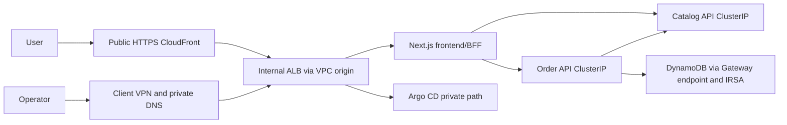

# TechX Platform

Staging release automation is being implemented. `verify.yml` calls reusable
acceptance and, only on trusted main after successful CI and when
`AUTOMATION_ENABLED=true`, the release workflow. It requires the `staging-release`
environment, AWS OIDC publisher role, `STAGING_SESSION_URI`, `RELEASE_APP_ID` and
`RELEASE_APP_PRIVATE_KEY`, plus a pinned `AUTOMATION_INFRA_SHA`. The job checks
the live cleanup schedule and holds a renewed S3 CAS lease across publishing
and chart PR creation. Keep automation disabled until all lifecycle leases,
independent cleanup, chart branch protections and post-deploy orchestration are
configured and verified. The workflow publishes immutable ECR images only for
a valid READY session and proposes a digest-pinned chart PR; it does not create
EKS or bypass chart review. Missing/unknown session state fails closed.

Minimal internship storefront implementing the end-to-end flow:

`browse products -> manage cart -> confirm order -> look up order`

This repository contains three independently runnable Node.js/TypeScript
services:

| Service       | Local port | Internal DNS       | Public exposure                      |
| ------------- | ---------: | ------------------ | ------------------------------------ |
| `frontend`    |     `3000` | `frontend:3000`    | Through the single frontend ALB only |
| `catalog-api` |     `3001` | `catalog-api:3001` | Private `ClusterIP`                  |
| `order-api`   |     `3002` | `order-api:3002`   | Private `ClusterIP`                  |

## Shared deployment contract

This table is the handoff contract copied verbatim across `techx-platform`,
`techx-chart`, and `techx-infra`. Contract changes must update all three
copies, every affected consumer, and the corresponding tests in one coordinated
change.

| Contract item        | Locked value                                                                                                                                                                                                                        |
| -------------------- | ----------------------------------------------------------------------------------------------------------------------------------------------------------------------------------------------------------------------------------- |
| AWS region           | `us-east-1`                                                                                                                                                                                                                         |
| Kubernetes namespace | `techx-staging`                                                                                                                                                                                                                     |
| Services / ports     | `frontend:3000`, `catalog-api:3001`, `order-api:3002`                                                                                                                                                                               |
| Cluster DNS          | `frontend.techx-staging.svc.cluster.local:3000`, `catalog-api.techx-staging.svc.cluster.local:3001`, `order-api.techx-staging.svc.cluster.local:3002`                                                                               |
| Secret / key         | Secret `techx-staging-secrets`, data key `order-api-key`; injected as `ORDER_API_KEY` only into frontend and Order                                                                                                                  |
| Runtime environment  | Frontend: `CATALOG_API_URL`, `ORDER_API_URL`, `ORDER_API_KEY`; Catalog: `CATALOG_PORT`; Order: `ORDER_PORT`, `CATALOG_API_URL`, `ORDER_API_KEY`, `ORDER_TABLE_NAME`, `AWS_REGION`, `ORDER_STORE_TTL_MS`, `ORDER_IDEMPOTENCY_TTL_MS` |
| Health / readiness   | Every service exposes unauthenticated `GET /healthz` and `GET /readyz`                                                                                                                                                              |
| Order store          | DynamoDB single-table persistence; orders retained 30 days, idempotency records 24 hours; TTL is enforced by the application and DynamoDB cleanup                                                                                   |
| Pricing              | Catalog price snapshot; shipping `999` cents below subtotal `5000`, otherwise free; `totalCents = subtotalCents + shippingCents`                                                                                                    |
| Images               | `058114477594.dkr.ecr.us-east-1.amazonaws.com/techx/frontend:staging-{short-sha}`, `.../techx/catalog:staging-{short-sha}`, `.../techx/order:staging-{short-sha}`                                                                   |
| Exposure             | CloudFront is the only public entry point and reaches one internal ALB through a VPC origin; Catalog, Order, and Argo CD remain `ClusterIP` services                                                                                |
| Public URL           | `https://shop.dinhminhkhoa.id.vn/`; public `/argocd` and `/argocd/*` return `403`                                                                                                                                                   |
| Private operator URL | The same hostname resolves to the internal ALB over AWS Client VPN; Argo CD is available only at `https://shop.dinhminhkhoa.id.vn/argocd/`                                                                                          |
| DNS and TLS          | Cloudflare owns public DNS, Route 53 provides the private split-view record, and one issued ACM certificate covers the storefront hostname                                                                                          |
| Network boundary     | One internal ALB serves frontend and Argo CD; only CloudFront may use HTTP `80`, only the Client VPN association security group may use HTTPS `443`                                                                                 |

The browser talks only to same-origin frontend routes. `ORDER_API_KEY` remains
server-side and is added by the frontend BFF when it calls Order API.

## API contract

- `GET /api/products`
- `GET /api/products/{id}`
- `GET /api/store-config`
- `POST /api/orders` with items, customer, US demo shipping address, and `shippingMethod: "standard"`
- `GET /api/orders/{id}`

The product list returns `{ "products": Product[], "categories":
CatalogCategory[] }`; category counts are derived by Catalog rather than
hard-coded in the UI. Product v2 includes SKU, explicit category, descriptions,
price/optional compare-at price, currency, availability, bounded inventory,
featured flag, tags, specifications, and local image metadata. Catalog validates
all seed records on startup and fails fast on an invalid or duplicate record.

Order creation accepts 1–20 item rows plus validated contact and US demo address
data. It trims product IDs, merges duplicates, enforces current catalog inventory,
and rejects an unavailable product atomically. Catalog price, SKU, name, and image
are snapshotted into each order item. Order owns shipping rules and exposes them
through `GET /api/store-config`; the response locks subtotal, shipping, total,
status, and estimated demo delivery dates. Only masked email and coarse destination
data are retained. The frontend never requests or processes card details.

Order endpoints require `X-TechX-Api-Key`. Create-order also requires an
`Idempotency-Key` of 8–128 characters. Repeating the same key and normalized
payload returns the original order; using the key with a different payload
returns `409`. Orders expire after 30 days by default and idempotency records
after 24 hours. DynamoDB persistence survives Order process restarts; raw
idempotency keys are SHA-256 hashed before database access and never retained.

Errors use:

```json
{
  "error": {
    "code": "STRING_CODE",
    "message": "Human-readable message",
    "requestId": "request-correlation-id"
  }
}
```

| Endpoint / condition                                                    | Status |
| ----------------------------------------------------------------------- | -----: |
| Successful list, lookup, health, readiness, or idempotent replay        |  `200` |
| Newly created order                                                     |  `201` |
| Invalid ID/body/content type/product/quantity/idempotency key           |  `400` |
| Missing or invalid `X-TechX-Api-Key` on Order API                       |  `401` |
| Product, order, or route not found                                      |  `404` |
| Unsupported method                                                      |  `405` |
| Reused idempotency key with a different payload                         |  `409` |
| Frontend create-order rate limit exceeded                               |  `429` |
| Catalog dependency, upstream, or required BFF configuration unavailable |  `503` |

## Topology and UI contract



The workspace `docs/PLAN.md` holds the current cross-repository plan and gates.
UI domain data comes from typed API contracts; navigation/content and
design tokens have one centralized owner. `scripts/ui-hardcode-audit.ps1` fails
verification when a component embeds catalog fixtures, product-specific values,
inline styles, direct route literals, or unsupported storefront claims.

## Repeatable verification and release

Run the complete local gate without AWS resources with one command:

```powershell
./scripts/acceptance.ps1
```

This runs static/unit/build checks, two-client DynamoDB Local integration,
parallel Docker Bake builds, and an isolated Compose stack with smoke,
resilience, recovery, soak and hardening checks. The stack uses a unique project
name and is cleaned up automatically; it does not use AWS credentials.

For an existing AWS staging environment, commit the reviewed source and chart
changes first. Use the normal AWS credential chain, then:

```powershell
./scripts/release-staging.ps1 -ExpectedAccountId '058114477594' `
  -Push -Context 'arn:aws:eks:us-east-1:058114477594:cluster/techx-staging'
```

The runner verifies the source, resumes missing immutable ECR images, waits for
vulnerability scans with no HIGH/CRITICAL findings, records full commit/digests
in the chart's `releases/staging.json`, updates all three image tags, verifies
the chart, commits/pushes its GitOps release, waits for Synced/Healthy and checks
the public deployment. Without `-Push`, it prepares and commits chart metadata
locally. It checks the selected cluster and Argo source before publishing to
`main`; concurrent upstream changes fail through a normal non-force Git push.
If deployment fails, the command stops with the release revision available for
diagnosis and Git revert; it does not report a successful deployment.

## Development

Install dependencies once, then run the three processes in separate PowerShell
terminals. The demo key below is local-only and must match between Order API and
the frontend BFF.

```powershell
npm ci

$env:CATALOG_PORT='3001'
npm run dev -w @techx/catalog-api

$env:CATALOG_API_URL='http://localhost:3001'
$env:ORDER_API_KEY='local-demo-key'
$env:ORDER_PORT='3002'
$env:ORDER_TABLE_NAME='techx-orders-local'
$env:AWS_REGION='us-east-1'
$env:AWS_ACCESS_KEY_ID='local'
$env:AWS_SECRET_ACCESS_KEY='local'
$env:ORDER_LOCAL_MODE='true'
$env:DYNAMODB_ENDPOINT='http://localhost:8000'
npm run dev -w @techx/order-api

$env:CATALOG_API_URL='http://localhost:3001'
$env:ORDER_API_URL='http://localhost:3002'
$env:ORDER_API_KEY='local-demo-key'
npm run dev -w @techx/frontend
```

Start DynamoDB Local first (the Compose workflow below bootstraps it), then open
`http://localhost:3000`. No AWS cloud resources are required for this workflow.
Before any later AWS apply, the repository must pass the local verification
gate:

```powershell
./scripts/verify.ps1
```

Developer quality commands are `npm run format`, `npm run format:check`,
`npm run lint`, `npm run check`, and `npm test`.

## Container and local end-to-end gate

Docker Compose publishes only the frontend on `http://localhost:3000`; both
backend services and DynamoDB Local stay on the internal Compose network. A
persistent volume retains local orders and the bootstrap service idempotently
creates the table and TTL configuration. All three application images target
`linux/amd64`, run with a numeric non-root UID, drop Linux capabilities, use a
read-only root filesystem, and receive only bounded writable `tmpfs` mounts.

```powershell
Copy-Item .env.example .env
# Replace ORDER_API_KEY in .env with a random local value of at least 8 characters.
$env:IMAGE_TAG='local'
docker compose config --quiet
docker compose build --pull
docker compose up -d --wait
./scripts/container-smoke.ps1
./scripts/container-recovery.ps1
./scripts/container-resilience.ps1
./scripts/container-soak.ps1 -DurationSeconds 60 -BurstRequests 30
./scripts/container-audit.ps1
docker compose down --volumes --remove-orphans
```

The recovery check restarts Catalog, Order, and frontend one at a time and
verifies that unrelated containers do not restart. The soak gate accepts `429`
only during its intentional create-order burst. Orders and idempotency records
remain available after an Order restart because DynamoDB Local owns the state.
The resilience gate concurrently repeats an idempotency key, correlates a safe
request ID in Order logs, checks that logs do not expose secrets, forces a
Catalog outage and bounded `503`, and verifies recovery and persisted lookup.
None of these commands contacts AWS or creates a billable cloud resource.

After a reviewed foundation apply creates the immutable ECR repositories, the
manual helper requires a clean, committed worktree to publish the three
`linux/amd64` images. It verifies the fixed AWS account/region, preserves existing
immutable images, resumes only missing components and blocks HIGH/CRITICAL scan
findings. It returns the source tag plus all three registry digests without
changing Git:

```powershell
./scripts/publish-ecr-images.ps1 -ExpectedAccountId '<12-digit-account-id>'
```

Use the returned `staging-<12-character-commit>` tag in the reviewed chart values
before Argo CD sync. Image publication is an AWS mutation and is run only inside
the approved foundation window.

## Cold publish from an admitted archive (source integration)

`ecr-publisher-core.ps1` contains the shared build/push/scan mechanics. The manual
entry point still checks Git cleanliness and resolves HEAD before calling it;
it has no skip-clean or caller-supplied commit override.

The separate infra `run_bootstrap_publish.py` entry point authenticates the exact
admitted S3 bundle version/hash and its three source SHAs. It runs CI on a fresh
archive and publishes from a second fresh extraction, so generated CI files do
not enter the image context. Archived source is audited without consulting an
ancestor Git checkout. The core receives the authenticated full platform SHA and
emits the same digest manifest used by normal releases.

Cold publish requires the dedicated protected `staging-bootstrap` OIDC role, an
APPLIED foundation, successful CodeBuild/SSM results, a live cleanup schedule and the separate
`bootstrap-publish` heartbeat lease in PROVISIONING. Normal release still requires
READY. The bootstrap role cannot create infrastructure or ECR repositories.

The gated `bootstrap-staging.yml` workflow accepts an existing session ID and
immutable execution VersionId. It verifies the real first-attempt main run at the
admitted platform SHA and the latest passing platform CI, then calls the infra
archive publisher. Set up main-only `staging-bootstrap`,
`AWS_BOOTSTRAP_PUBLISHER_ROLE_ARN`, `TECHX_STATE_BUCKET`, the exact reviewed
`AUTOMATION_INFRA_SHA` and the chart-scoped release App before authorized activation.
Keep `LIFECYCLE_ENABLED` false until the complete workspace acceptance gates pass.

After publication, preparation uses read-only GitHub access to compare both
rendered release files with the admitted baseline. A real one-file or two-file
diff obtains the chart-only App token and proposes the allowed release changes.
It never merges, rebases or updates an existing proposal branch. When the exact
release already exists, it writes a session-bound reuse intent without a GitHub
write or installation token; a separate protected infra workflow previews the
baseline/digests/deadline and requires a fresh human review before selection.
Neither case bypasses current source/CI, session, lease or cleanup guards.
The source caller and opening workflow exist; full callback orchestration,
promotion/acceptance/rollback and live cloud verification remain incomplete.
The App token has repository contents/PR write permissions; the fixed helper
avoids merge operations. Main branch protection is configured, while the
promotion/session gate and live token behavior still need acceptance before
activation. Keep both automation flags false until those gates pass.

## Attribution

The visual direction and sample commerce-domain patterns are adapted selectively
from the TechX/OpenTelemetry demo sources. New implementation code in this
repository is intentionally reduced to the internship thin slice.

Licensed under Apache-2.0. See [LICENSE](LICENSE).
