# Frontend

The TechX storefront is a Next.js 16 App Router application. It renders the
browser UI and acts as a small Backend-for-Frontend (BFF) that keeps upstream
service URLs and the Order API key on the server.

The browser only calls same-origin `/api/*` routes. Route handlers add the
`X-TechX-Api-Key` header when they call Order API; `ORDER_API_KEY` is never
included in browser JavaScript, HTML, or a `NEXT_PUBLIC_` variable.

## Technology

- Next.js 16 (App Router, React Server Components and client components)
- React 19 and TypeScript
- Vitest, Testing Library, jsdom, and axe-core
- Plain CSS with shared tokens and responsive breakpoints in
  `app/globals.css`

## Folder structure

```text
src/frontend/
├── app/
│   ├── api/                    # Server-side BFF route handlers
│   │   ├── products/           # GET /api/products, GET /api/products/:id
│   │   ├── orders/             # POST /api/orders, GET /api/orders/:id
│   │   └── store-config/       # GET /api/store-config
│   ├── cart/                   # /cart
│   ├── checkout/               # /checkout
│   ├── order/[id]/             # /order/:id (confirmation and detail)
│   ├── orders/                 # /orders (order lookup and browser history)
│   ├── product/[id]/           # /product/:id
│   ├── products/               # /products (search, filters, sort)
│   ├── healthz/                # Liveness probe
│   ├── readyz/                 # Readiness probe
│   ├── globals.css             # Design tokens, layout, responsive rules
│   ├── layout.tsx              # Shell, providers, header and footer
│   └── page.tsx                # / (home)
├── components/
│   ├── cart/                   # Cart dropdown, line item, summary
│   ├── layout/                 # Header, navigation, sidebar, footer
│   ├── order/                  # Shared order details
│   ├── product/                # Product grid and product card
│   └── ui/                     # Button, badge, icon, quantity, empty state
├── lib/
│   ├── api-client.ts           # Browser fetch helpers for same-origin /api/*
│   ├── cart.ts                 # Cart normalisation, limits, and pricing
│   ├── CartContext.tsx         # Cart state and session persistence
│   ├── catalog.ts              # Search, filter, sort, related products
│   ├── checkout.ts             # Form validation and order payloads
│   ├── order-history.ts        # Browser-only order history
│   ├── server/                 # BFF proxy, rate limit, body limits
│   ├── site-config.ts          # Routes, UI copy, limits, timings
│   ├── StorefrontContext.tsx   # Catalog and store configuration state
│   └── types.ts                # Shared Product v2 and Order v2 types
├── public/products/            # Local product images
├── test/                       # Unit, component, BFF, and accessibility tests
├── docs/screenshots/           # Before/after UI evidence
├── Dockerfile
├── next.config.mjs             # Standalone output and security headers
├── package.json
└── vitest.config.ts
```

## Main pages

| Route          | Purpose                                                                  |
| -------------- | ------------------------------------------------------------------------ |
| `/`            | Storefront home, category links, featured products, delivery rule        |
| `/products`    | Catalog search, category/price/availability filters, sorting, empty UI   |
| `/product/:id` | Product detail, gallery, quantity, add to cart, related products         |
| `/cart`        | Editable cart lines, free-delivery progress, order summary               |
| `/checkout`    | Contact and US demo address form, validation, review, place order        |
| `/order/:id`   | Order confirmation and detail, with a cache fallback and retry           |
| `/orders`      | Order ID lookup, invalid/expired/API error states, browser order history |
| `/api/*`       | Same-origin BFF endpoints used by the browser                            |
| `/healthz`     | Unauthenticated liveness probe                                           |
| `/readyz`      | Unauthenticated readiness probe                                          |

## Browser → BFF → API flow

```text
Browser (client component)
   │  fetch("/api/products"), fetch("/api/store-config")
   │  POST /api/orders, GET /api/orders/:id
   ▼
Next.js BFF route handler (server only)
   │  CATALOG_API_URL ──────────────► Catalog API /api/products
   │  ORDER_API_URL   ──────────────► Order API /api/store-config
   │                                  Order API /api/orders
   │                                  X-TechX-Api-Key: ORDER_API_KEY
   ▼
JSON response with the same status and an error envelope when needed
```

- `app/api/*` handlers stream request bodies with a 16 KiB limit, apply
  dependency timeouts, retry safe GET requests, and forward request IDs.
- `POST /api/orders` is limited to 20 attempts per client per minute and
  returns `429` with `Retry-After` when the limit is exceeded.
- Upstream failures become a typed `503` error envelope
  (`BFF_NOT_READY`, `DEPENDENCY_UNAVAILABLE`, or
  `INVALID_UPSTREAM_RESPONSE`) so the UI can show a clear message and offer a
  retry.
- The browser receives only catalog/order data. The API key exists only in the
  server process environment and the outbound header added by the BFF.

## Environment configuration

All variables below are server-side. Do not rename any of them with a
`NEXT_PUBLIC_` prefix.

| Variable          | Required | Used by                       | Purpose                                                                |
| ----------------- | :------: | ----------------------------- | ---------------------------------------------------------------------- |
| `CATALOG_API_URL` |   Yes    | `/api/products`, store config | Internal Catalog API base URL, for example `http://localhost:3001`     |
| `ORDER_API_URL`   |   Yes    | `/api/orders`, store config   | Internal Order API base URL, for example `http://localhost:3002`       |
| `ORDER_API_KEY`   |   Yes    | `/api/orders` POST and lookup | Server-only credential sent as `X-TechX-Api-Key`; minimum 8 characters |

The package scripts fix the frontend port at `3000`. Compose maps
`FRONTEND_PORT` on the host to container port `3000`.

`ORDER_API_KEY` must match the value configured in Order API. The repository's
`.env.example` contains a local-only placeholder:

```dotenv
CATALOG_API_URL=http://localhost:3001
ORDER_API_URL=http://localhost:3002
ORDER_API_KEY=replace-with-a-random-local-value
```

## Running the frontend

Install dependencies once from the `techx-platform` root:

```bash
npm ci
```

### Run the frontend against locally running APIs

Start Catalog API and Order API first. Order API requires its DynamoDB Local
table and the same `ORDER_API_KEY` as the frontend. Then, from the repository
root:

```bash
CATALOG_API_URL=http://localhost:3001 \
ORDER_API_URL=http://localhost:3002 \
ORDER_API_KEY=local-demo-key \
npm run dev -w @techx/frontend
```

On PowerShell:

```powershell
$env:CATALOG_API_URL='http://localhost:3001'
$env:ORDER_API_URL='http://localhost:3002'
$env:ORDER_API_KEY='local-demo-key'
npm run dev -w @techx/frontend
```

Open <http://localhost:3000>. The dev server binds to `0.0.0.0` on port `3000`.
The repository root README describes starting Catalog API, Order API, and
DynamoDB Local individually.

### Run the complete local stack with containers

From the repository root:

```bash
cp .env.example .env
# Replace ORDER_API_KEY in .env with a random value of at least 8 characters.
docker compose up -d --build --wait
```

Compose publishes only the frontend at <http://localhost:3000>; Catalog API,
Order API, and DynamoDB Local remain on the internal network.

## Checks and tests

Run these from the `techx-platform` root:

```bash
npm run check -w @techx/frontend   # TypeScript
npm run test -w @techx/frontend    # Vitest, component, BFF, accessibility
npm run build -w @techx/frontend   # Production Next.js build
```

To inspect the production build:

```bash
npm run start -w @techx/frontend
```

The test suite covers product search and filtering, cart add/update/remove,
checkout validation and API errors, order lookup and retry states, rate
limiting, request-body limits, BFF proxy behaviour, and accessibility smoke
checks.

## Manual verification checklist

1. Open `/products`; search by name/SKU, apply category, price, and
   availability filters, change sorting, and confirm the result count and empty
   state. Use **Reset** to restore the full collection.
2. Open a product, change the quantity, add it to the cart, then update and
   remove the line on `/cart`. Confirm the summary and free-delivery progress.
3. Open `/checkout`; submit empty fields to see validation messages and focus
   the first invalid field. Complete the form and place an order. Confirm the
   order confirmation page.
4. Open `/orders`; enter an incomplete ID to see the local error, then a valid
   order ID to see details. Stop Order API and repeat to verify the retryable
   error message.
5. Check layout at desktop (1280×900) and mobile (390×844). Confirm the mobile
   checkout shows the order review above the form and that the filter drawer
   cannot receive keyboard focus while closed.
6. Use Tab/Shift+Tab through the header, catalog filters, cart controls, and
   checkout form. Confirm the skip link, visible focus ring, and Enter-key form
   submission.
7. In browser DevTools → Network, confirm page traffic uses only same-origin
   `/api/*` requests. Confirm no response or bundle contains
   `ORDER_API_KEY`.

## BFF verification

```bash
# Catalog response through the BFF
curl -s http://localhost:3000/api/products | head

# Store configuration through the BFF
curl -s http://localhost:3000/api/store-config

# A missing order is a clean JSON error, not a browser-visible key or stack
curl -s -i http://localhost:3000/api/orders/ord_00000000-0000-4000-8000-000000000000

# The key must only be referenced in server route handlers
grep -rn "ORDER_API_KEY" src/frontend/app src/frontend/lib | grep -v test
```

The BFF integration test uses real local Catalog and Order servers and asserts
that created and looked-up order responses do not contain the API key.

## Screenshots

Captured from the local stack with a seeded two-item cart and an existing order.
Desktop is 1280×900; mobile is 390×844.

### Before and after

| Page         | Before                                                             | After                                                            |
| ------------ | ------------------------------------------------------------------ | ---------------------------------------------------------------- |
| Products     | 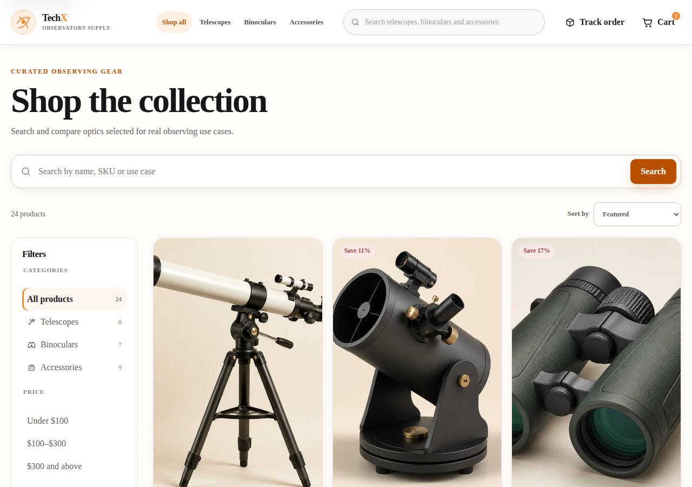   | 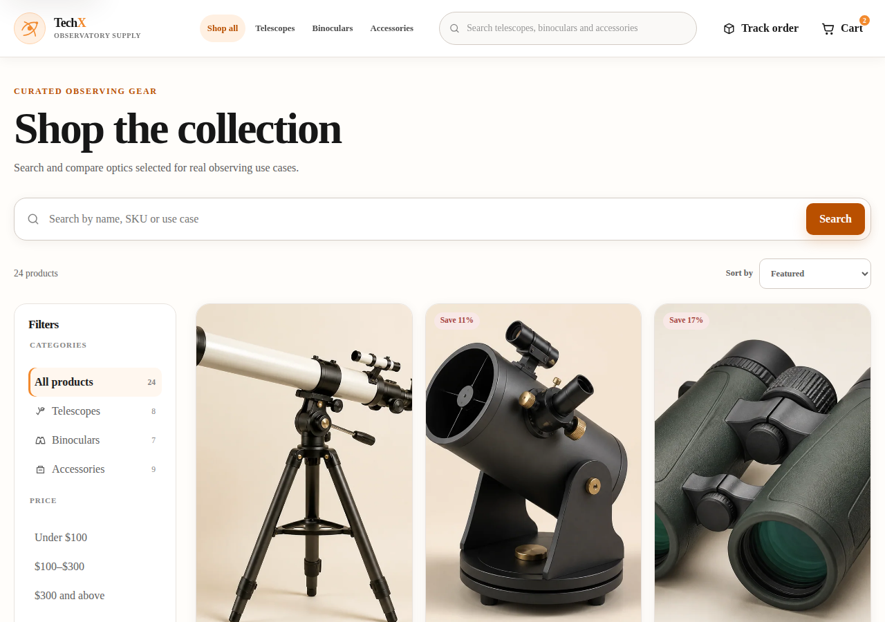   |
| Cart         | 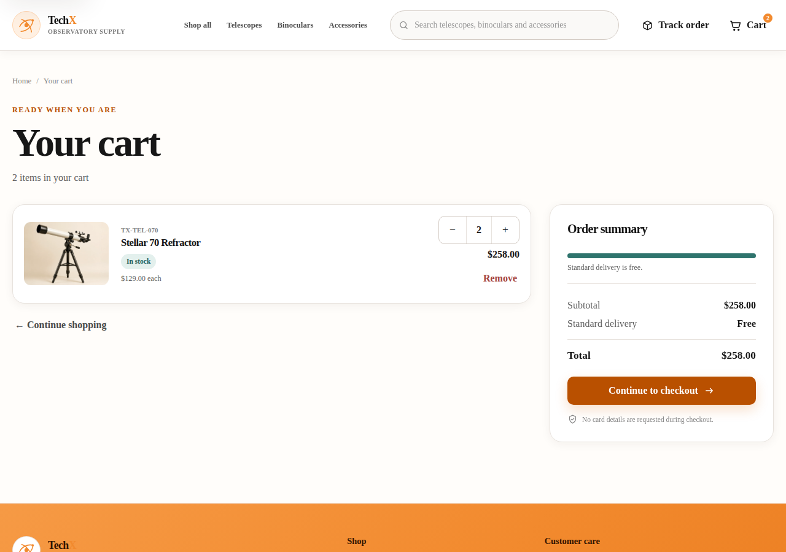           | 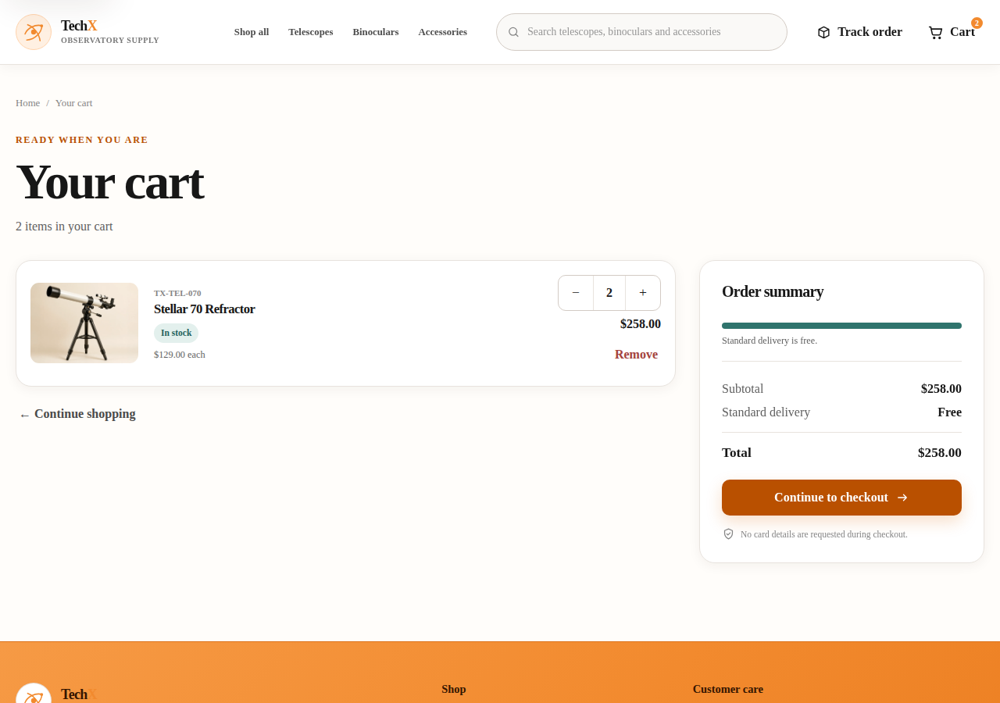           |
| Checkout     | 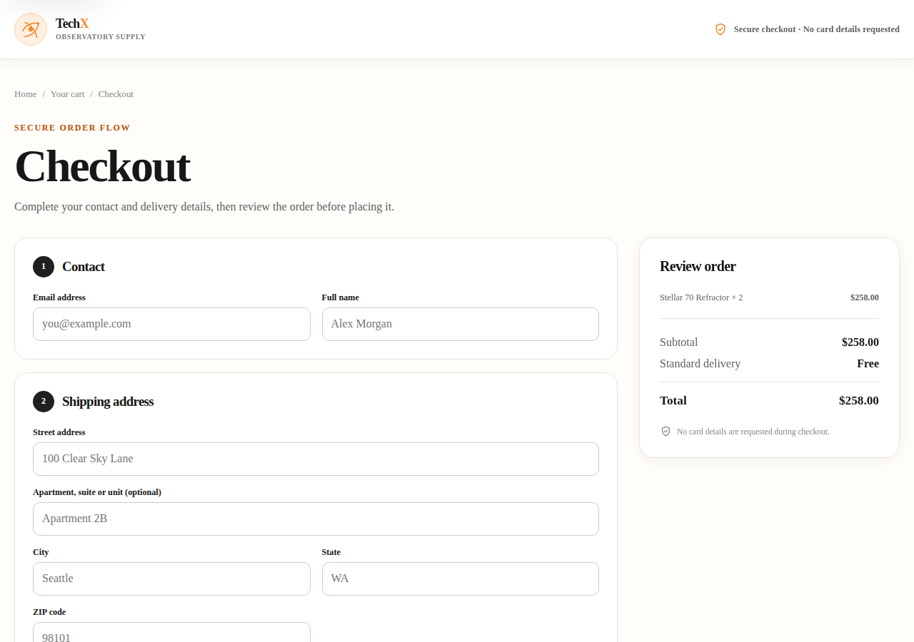   | 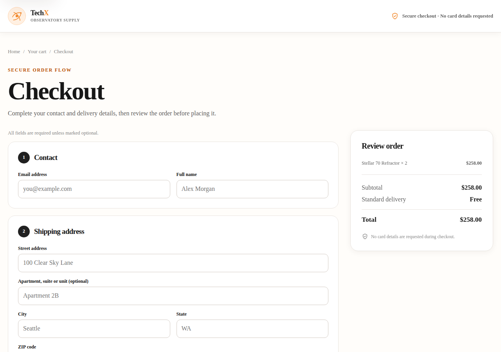   |
| Order lookup | 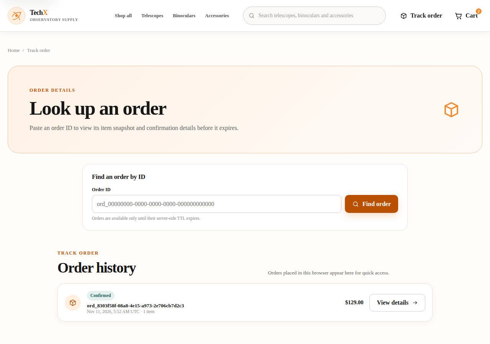 | 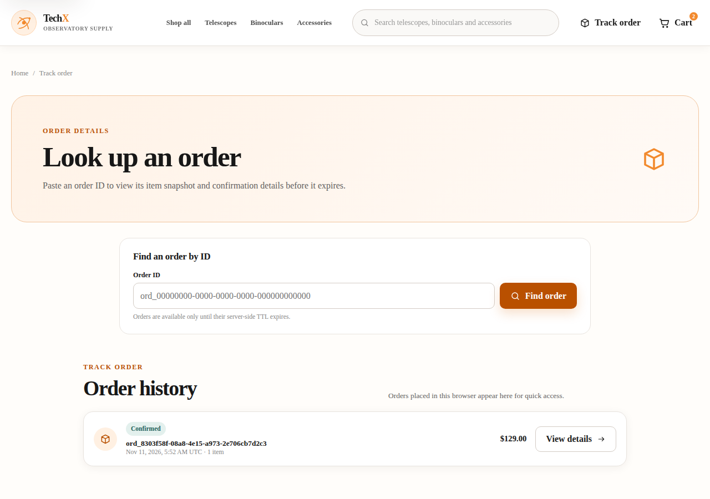 |

### Updated mobile layout

| Products                                                       | Cart                                                   | Checkout                                                       | Order lookup                                                     |
| -------------------------------------------------------------- | ------------------------------------------------------ | -------------------------------------------------------------- | ---------------------------------------------------------------- |
| 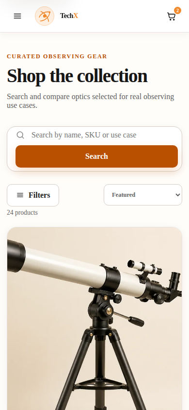 | 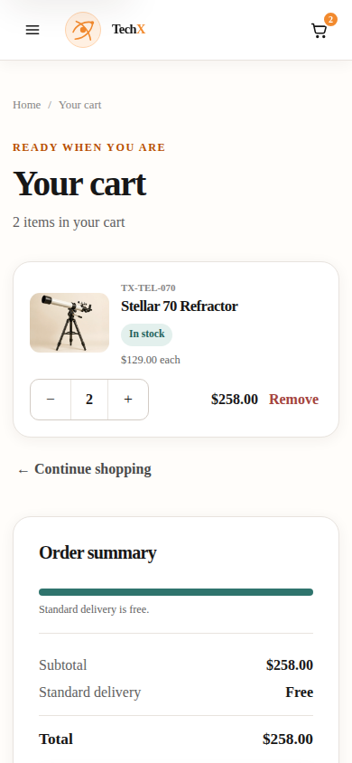 | 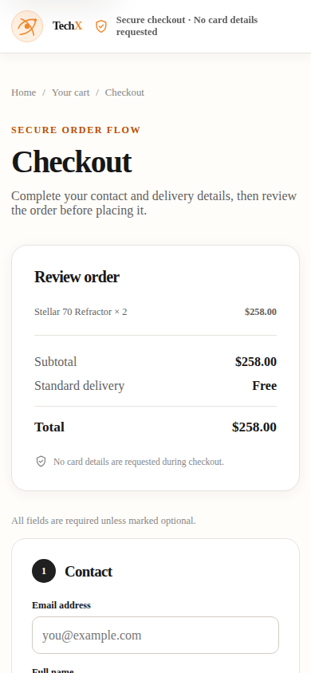 | 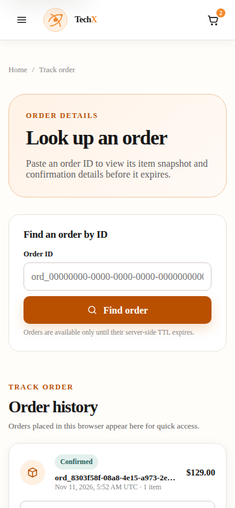 |

Additional screenshots:

- [Product detail (desktop)](docs/screenshots/after/product-detail-desktop.png)
- [Product detail (mobile)](docs/screenshots/after/product-detail-mobile.png)
- [Order lookup result (desktop)](docs/screenshots/after/orders-result-desktop.png)
- [Order lookup result (mobile)](docs/screenshots/after/orders-result-mobile.png)

The main visible changes are the mobile checkout review panel appearing before
the form, clearer validation/retry copy, accessible remove/quantity controls,
the catalog **Reset** action for active search/filter state, and explicit
loading/error states on product and order pages.
