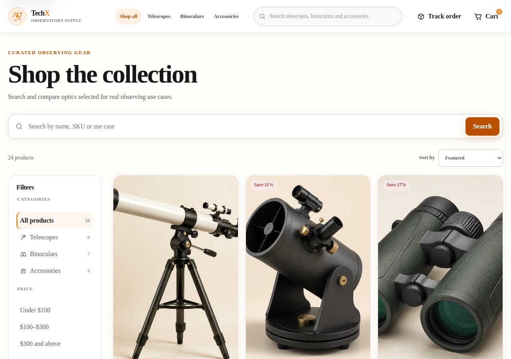
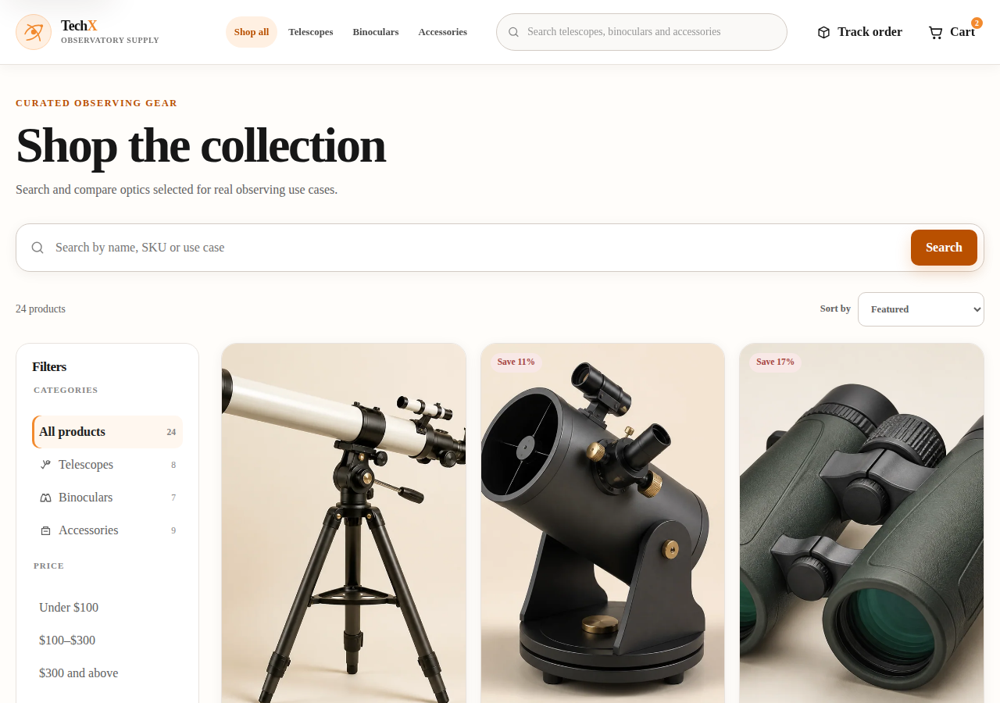
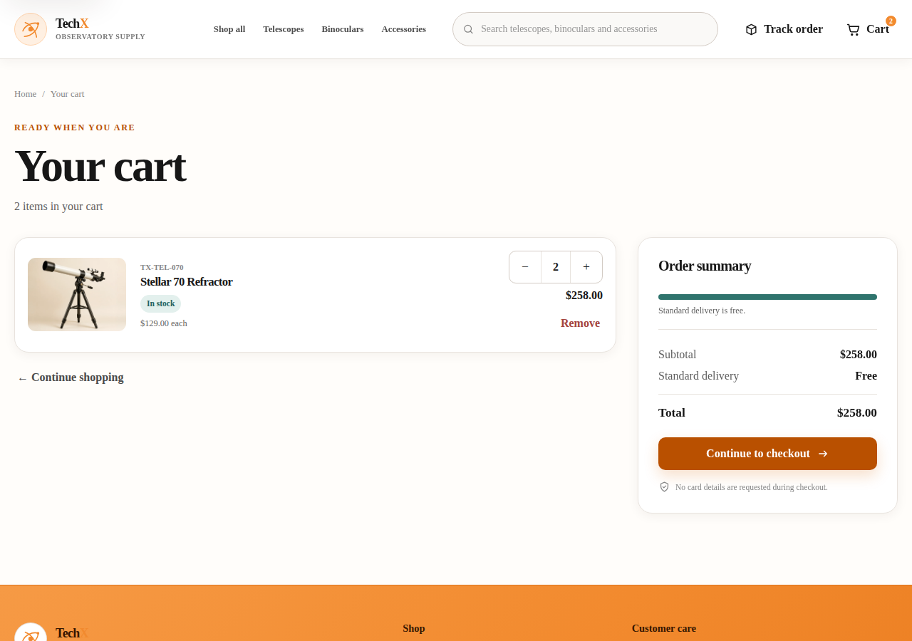
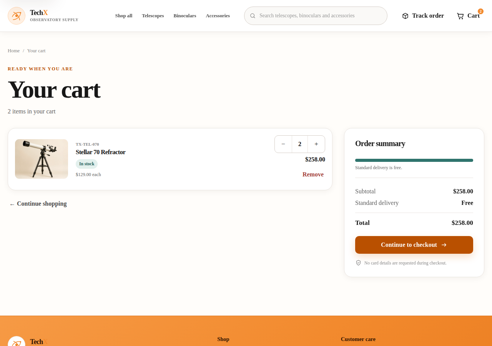
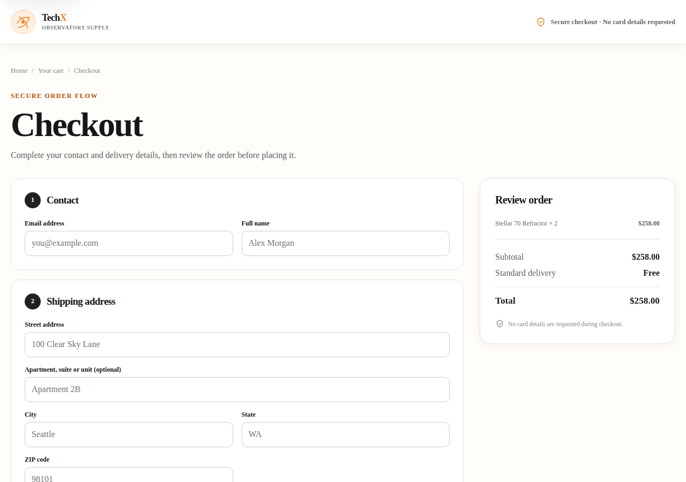
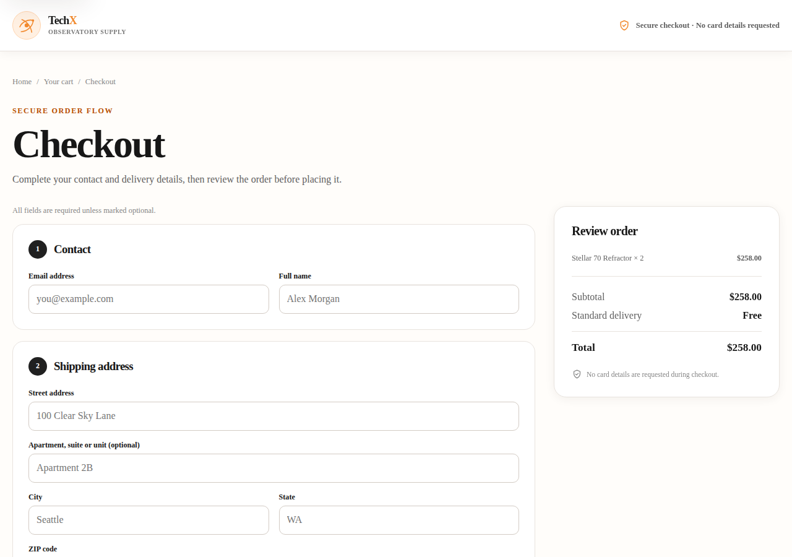
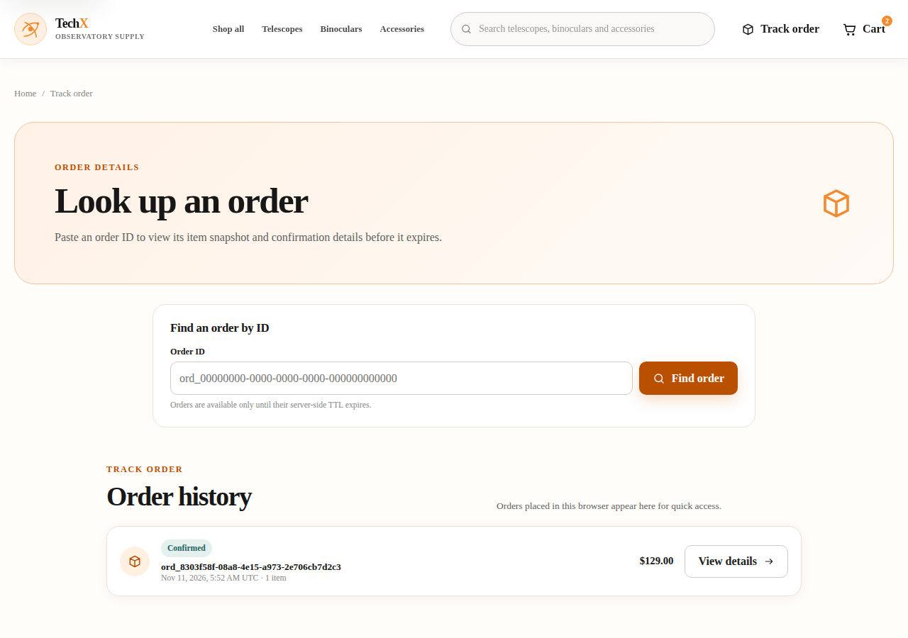
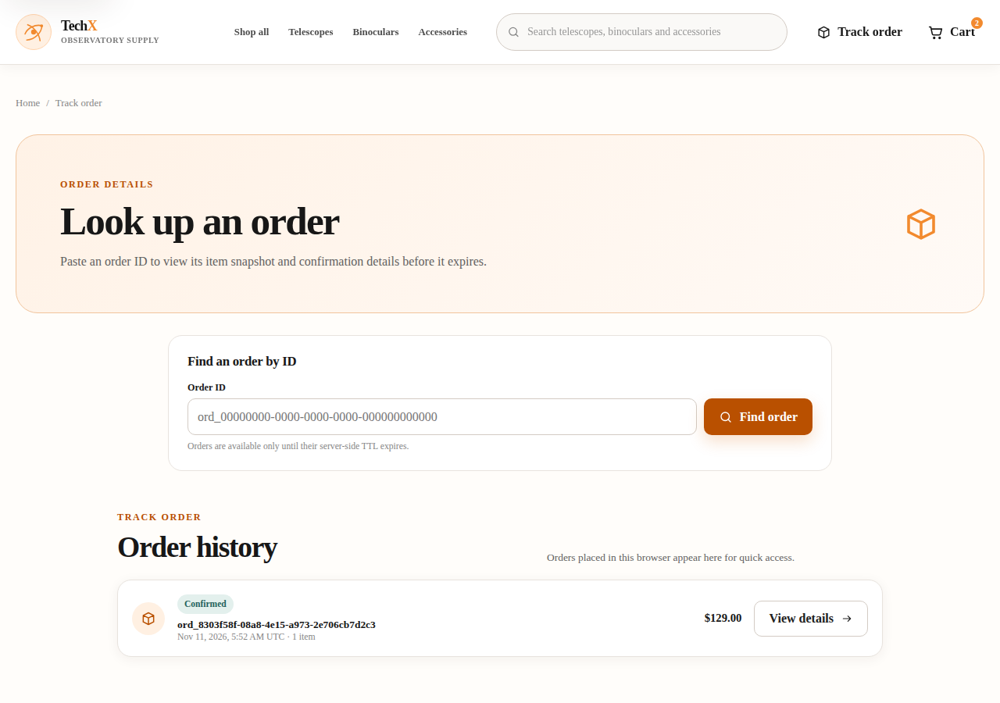

# Frontend UI polish, error states, tests, and documentation

## Summary

Small storefront UI improvements across product browsing, cart, checkout, and
order lookup, plus a rewritten frontend README that documents the current folder
structure, pages, BFF request flow, environment variables, local setup, checks,
and screenshots.

The branch also fixes the container image build: the Dockerfiles pinned
`zlib=1.3.2-r1`, which no longer exists for the current Alpine 3.24 base image,
so `docker buildx bake` failed before CI could run the application checks.

## Source revision

- Base/merge revision: `49b4d6ab3280c857a40cf7c18d193ba4078bd8fd`
  (`49b4d6a Merge pull request #5 from cloud-computing-microservice/codex/ready-release-candidate`)
- Branch: `issue/hung`
- Commits:
  - `feat(frontend): polish storefront UI states, add tests and docs`
  - `fix(docker): upgrade zlib instead of pinning removed package version`
- Change scope: `src/frontend/**` and the three service `Dockerfile`s

## Environment

| Item             | Value                       |
| ---------------- | --------------------------- |
| OS               | Linux 7.0.0-38-generic      |
| Node.js          | v22.22.1                    |
| npm              | 9.2.0                       |
| Next.js          | 16.4.2                      |
| React            | 19.2.8                      |
| Test runner      | Vitest 4.1.12               |
| Browser          | Google Chrome 157.0.8103.38 |
| Desktop viewport | 1280 × 900                  |
| Mobile viewport  | 390 × 844                   |

Local stack used for screenshots and manual checks:

- Catalog API on `http://localhost:3001`
- Order API (fake in-memory repository, same server contract) on
  `http://localhost:3002`
- Next.js frontend on `http://localhost:3000`
- `ORDER_API_KEY=local-demo-key` set only on the frontend and Order servers

## What changed

### UI and UX

- **Product detail:** added an explicit catalog error state with **Try again**
  and **Continue shopping** actions instead of incorrectly showing "Product not
  found" when the catalog request fails. Added selected-thumbnail state and an
  accessible quantity label.
- **Catalog:** added a **Reset** action in the results toolbar whenever a search
  or filter is active. The filter drawer is now hidden from keyboard navigation
  while closed on mobile, and the filter toggle exposes
  `aria-controls`/`aria-expanded`.
- **Cart:** remove controls now include the product name in their accessible
  name, so repeated "Remove" buttons are distinguishable.
- **Checkout:** added clear required-field copy, field length limits,
  disabled inputs while submitting, an `aria-busy` form state, a validation
  retry hint, and email-first error focus. On mobile the **Review order** panel
  now appears above the form so totals are visible before data entry.
- **Order lookup:** fixed stale `aria-invalid` state after editing, added
  `aria-busy` and a polite live region for results, and added clear messages for
  network, BFF configuration, invalid upstream, and unexpected errors.
- **Order confirmation:** added **Try again** for transient load failures while
  preserving the existing cached-order fallback.
- **Loading states:** all full-page loading states now expose `role="status"`.

### Container build / CI

- Replaced the stale `apk add --no-cache zlib=1.3.2-r1` pin in the runtime stage
  of all three images with `apk upgrade --no-cache zlib`.
- The pinned `1.3.2-r1` package is no longer published for the Alpine 3.24 base
  image (`node:22-alpine@sha256:0a7108...`), which made the image build fail with
  `breaks: world[zlib=1.3.2-r1]` before any tests ran.
- The new command keeps zlib at the latest patched revision without tying the
  build to a package version that upstream can remove.
- Verified `docker buildx bake catalog frontend order` succeeds and that all
  three runtime images contain `zlib-1.4-r0`.

### Documentation

- Rewrote `src/frontend/README.md` with:
  - folder structure and ownership boundaries
  - main pages and routes
  - browser → same-origin BFF → Catalog/Order API flow
  - server-only environment configuration and `ORDER_API_KEY` trust boundary
  - local and container run instructions
  - check/test/build commands and manual verification checklist
  - BFF verification commands
  - before/after and mobile screenshots

### Tests

- Added/updated UI tests for:
  - product search/category filtering, search submission, empty state, loading
    skeletons, catalog error retry
  - product detail error/not-found states, quantity selection, add to cart
  - cart empty state, quantity changes, remove, unavailable-item checkout block
  - checkout empty state, validation and focus, API error recovery, successful
    order submission
  - order lookup invalid input clearing, loading state, successful lookup,
    confirmation retry, typed not-found error
- Extended BFF integration coverage to assert a missing `ORDER_API_KEY`
  returns a safe `BFF_NOT_READY` error without leaking the key.
- Updated the checkout contract test for email-first validation order.

## Screenshots

Full set: `src/frontend/docs/screenshots/before/` and
`src/frontend/docs/screenshots/after/`.

| Page         | Before                                                        | After                                                       |
| ------------ | ------------------------------------------------------------- | ----------------------------------------------------------- |
| Products     |    |    |
| Cart         |            |            |
| Checkout     |    |    |
| Order lookup |  |  |

Mobile after screenshots:

- [Products](screenshots/after/products-mobile.png)
- [Cart](screenshots/after/cart-mobile.png)
- [Checkout](screenshots/after/checkout-mobile.png)
- [Order lookup](screenshots/after/orders-mobile.png)

The clearest visual change is the mobile checkout: before, the form came first
and totals were below the Place order button; after, the review panel is shown
above the form. Error/retry copy and the catalog Reset action are visible on the
corresponding interactive states.

## Test steps, expected and actual results

| #   | Test step                                                            | Expected                                                                                           | Actual |
| --- | -------------------------------------------------------------------- | -------------------------------------------------------------------------------------------------- | ------ |
| 1   | Search/filter `/products` by category and query; submit a new search | Only matching products; URL updates without reload; Reset appears                                  | Pass   |
| 2   | Submit an empty checkout form                                        | Email error appears first and receives focus; all required errors visible                          | Pass   |
| 3   | Make Order API unavailable and submit checkout                       | Alert with clear message; form and cart remain; Place order re-enabled                             | Pass   |
| 4   | Add product, change quantity, remove line                            | Counts/totals update; session cart persists; remove control names the product                      | Pass   |
| 5   | Look up incomplete ID, then valid ID, then trigger an API error      | Local error without API call; valid result renders; API error is human-readable and retryable      | Pass   |
| 6   | Fail the first confirmation load, then retry                         | Error state remains usable; Try again reloads the order                                            | Pass   |
| 7   | Check 1280×900 and 390×844 layouts                                   | No overflow; checkout review panel first on mobile; filter drawer closed is not keyboard reachable | Pass   |
| 8   | Keyboard navigation through header, catalog, cart, checkout          | Skip link, visible focus, Enter submission, logical tab order                                      | Pass   |
| 9   | Inspect browser traffic                                              | Only same-origin `/api/*` requests; no `ORDER_API_KEY` in responses or bundles                     | Pass   |
| 10  | Run required frontend checks                                         | Type check, 47 tests, and production build all pass                                                | Pass   |
| 11  | Build all three container images                                     | `docker buildx bake` completes; runtime images contain a patched zlib                              | Pass   |

## Commands and logs

Run from the `techx-platform` root:

```bash
npm run check -w @techx/frontend
npm run test -w @techx/frontend
npm run build -w @techx/frontend
```

### `npm run check -w @techx/frontend`

```text
> @techx/frontend@0.1.0 check
> tsc --noEmit
```

Exit code: `0`.

### `npm run test -w @techx/frontend`

```text
 RUN  v4.1.12 /home/hungtran/clound-final/techx-platform/src/frontend

 Test Files  15 passed (15)
      Tests  47 passed (47)
   Duration  30.43s
```

Exit code: `0`.

### `npm run build -w @techx/frontend`

```text
▲ Next.js 16.4.2 (Turbopack)
✓ Running next.config.mjs took 58ms
  Creating an optimized production build ...
✓ Compiled successfully in 13.7s
  Running TypeScript ...
  Finished TypeScript in 20.6s
✓ Generating static pages using 3 workers (12/12) in 1948ms
  Finalizing page optimization ...

Route (app)
┌ ○ /
├ ○ /_not-found
├ ƒ /api/orders
├ ƒ /api/orders/[id]
├ ƒ /api/products
├ ƒ /api/products/[id]
├ ƒ /api/store-config
├ ○ /cart
├ ○ /checkout
├ ƒ /healthz
├ ƒ /order/[id]
├ ○ /orders
├ ƒ /product/[id]
├ ○ /products
└ ƒ /readyz
```

Exit code: `0`.

### Container image build

```bash
ORDER_API_KEY=local-demo-key docker buildx bake catalog frontend order
```

All three targets exported successfully:

```text
techx/frontend:local   zlib-1.4-r0
techx/order:local      zlib-1.4-r0
techx/catalog:local    zlib-1.4-r0
```

Exit code: `0`.

### BFF key-boundary check

```text
GET /api/products                         200
GET /api/store-config                     200
GET /api/orders/<valid-id>                200
POST /api/orders                          201
POST /api/orders (same idempotency key)   200 replay
POST /api/orders after burst limit        429 + Retry-After
GET /api/orders/<id> without key config   503 BFF_NOT_READY
```

The BFF integration test also asserts that response bodies do not contain the
configured `ORDER_API_KEY`.

## Known limitations

- The order screenshots use Order API's in-memory fake repository rather than
  DynamoDB Local; the HTTP contract and UI behaviour are identical.
- Screenshots are captured from the rebuilt working tree; the checked-in
  `before/` images were captured from `HEAD` before applying the UI changes.
